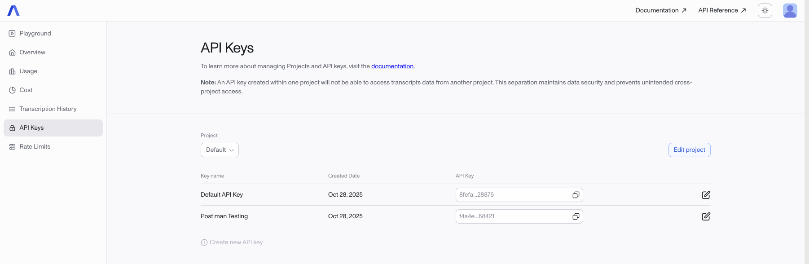

# Obtaining AssemblyAI API Key

To use the Krista AssemblyAI extension, you need an API key from AssemblyAI.

## Step 1: Create an AssemblyAI Account

1. Go to [AssemblyAI website](https://www.assemblyai.com/)
2. Click on **"Sign Up"** or **"Get Started"**
3. Fill in your details:
   - Email address
   - Password
   - Company name (optional)
4. Verify your email address

## Step 2: Access Your Dashboard

1. Log in to your AssemblyAI account
2. You will be redirected to the AssemblyAI Dashboard
3. The dashboard shows your usage statistics and API access

## Step 3: Locate Your API Key

1. In the AssemblyAI Dashboard, look for the **"API Key"** section
2. Your API key is displayed on the main dashboard page
3. The API key format looks like: `f4a4eb8c18db4fb280606244e0d68421`

## Step 4: Copy Your API Key

1. Click the **"Copy"** button next to your API key
2. Store the API key securely - you'll need it to configure the Krista extension
3. **Important**: Keep your API key confidential and never share it publicly

## Step 5: Choose Your Plan

AssemblyAI offers different pricing plans:

* **Free Tier**: 
  - 5 hours of transcription per month
  - Access to all features
  - Perfect for testing and development

* **Pay-as-you-go**:
  - $0.00025 per second (~$0.015 per minute)
  - No monthly commitment
  - Suitable for variable workloads

* **Enterprise**:
  - Custom pricing
  - Volume discounts
  - Dedicated support
  - SLA guarantees

## API Key Security Best Practices

### Do's ✅
- Store API keys in secure credential management systems
- Use environment variables for API keys in development
- Rotate API keys periodically
- Use different API keys for development and production
- Monitor API usage regularly

### Don'ts ❌
- Never commit API keys to version control
- Don't share API keys via email or chat
- Don't hardcode API keys in source code
- Don't use production keys in development environments
- Don't expose API keys in client-side code

## Regenerating Your API Key

If your API key is compromised:

1. Log in to AssemblyAI Dashboard
2. Navigate to **Settings** or **API Keys**
3. Click **"Regenerate API Key"**
4. Confirm the regeneration
5. Update the key in all your applications immediately

**Warning**: Regenerating your API key will invalidate the old key immediately, which may break existing integrations.

## Troubleshooting

### Can't Find API Key
- Make sure you're logged into the correct AssemblyAI account
- Check if you've completed email verification
- Contact AssemblyAI support if the issue persists

### API Key Not Working
- Verify you've copied the entire key without extra spaces
- Check if your account is active and in good standing
- Ensure you haven't exceeded your plan's limits
- Verify the API key hasn't been regenerated

### Need Help?
- Visit [AssemblyAI Documentation](https://www.assemblyai.com/docs)
- Contact [AssemblyAI Support](https://www.assemblyai.com/support)
- Check [AssemblyAI Status Page](https://status.assemblyai.com/) for service issues

